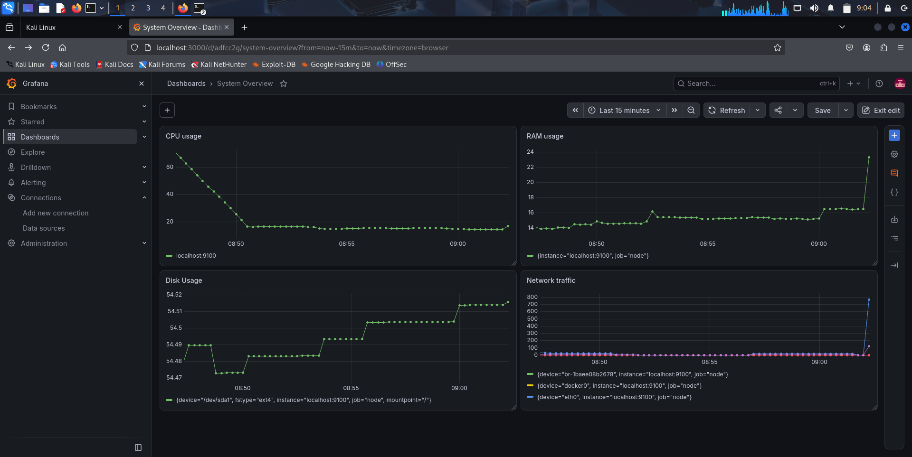

# Infrastructure Monitoring with RAG

An infrastructure monitoring and incident investigation project built using **Go, Nginx, Prometheus, Grafana, Loki, Grafana Alloy, and Python**.

The system collects infrastructure metrics and application logs, retrieves relevant operational runbooks, and combines them into an evidence set for incident investigation.

## Architecture

```text
                         Client
                           |
                           v
                       Nginx :80
                           |
                           v
                    Go Backend :8080
                           |
                           v
                  Nginx Access Logs
                           |
                           v
                    Grafana Alloy
                           |
                           v
                       Loki :3100
                           |
                           v
                       Python RAG
                      /    |    \
                     /     |     \
              Runbooks  Prometheus  Loki
                          |
                          v
                    Node Exporter
                          |
                          v
                    System Metrics
```

## Technology Stack

* **Go** — backend service
* **Nginx** — reverse proxy
* **Prometheus** — metrics collection and querying
* **Node Exporter** — system metrics
* **Grafana** — monitoring and visualization
* **Loki** — log aggregation
* **Grafana Alloy** — log collection and shipping
* **Python** — RAG and incident investigation
* **Markdown** — operational runbooks

## Monitoring Dashboard

The Grafana dashboard provides visibility into:

* CPU usage
* RAM usage
* Disk usage
* Network traffic



## RAG Pipeline

The Python RAG layer combines information from operational runbooks, Prometheus, and Loki.

```text
                    User Question
                         |
                         v
                    Python RAG
                         |
          +--------------+--------------+
          |              |              |
          v              v              v
      Runbooks      Prometheus         Loki
          |              |              |
          v              v              v
      Operational      Live           Recent
      Knowledge      Metrics          Logs
          \              |              /
           \             |             /
            +------------+------------+
                         |
                    Evidence Bundle
```

The system can:

1. Retrieve a relevant operational runbook.
2. Query Prometheus for system metrics.
3. Query Loki for recent Nginx logs.
4. Combine the information into an evidence set for investigation.

## Runbooks

The knowledge base currently contains runbooks for:

* High CPU
* High Memory
* Nginx 502 Bad Gateway
* Service Down

Each runbook contains symptoms, investigation steps, possible causes, and remediation guidance.

## Project Structure

```text
.
├── main.go
├── go.mod
├── go.sum
├── prometh.yml
│
├── rag/
│   ├── main.py
│   ├── retrieve.py
│   ├── prometheus.py
│   └── loki.py
│
├── knowledge/
│   └── runbooks/
│       ├── high_cpu.md
│       ├── high_memory.md
│       ├── nginx_502.md
│       └── service_down.md
│
└── screenshots/
    └── grafana-system-overview.png
```

## Future Work

* Integrate **Ollama** as a local LLM for AI-assisted incident analysis.
* Generate natural-language explanations using the collected metrics, logs, and runbooks.
* Use the model to assist with identifying possible causes and recommended investigation steps.

## Project Goal

The goal of this project is to explore how **observability data, operational knowledge, and RAG can be combined to assist with infrastructure incident investigation**.
